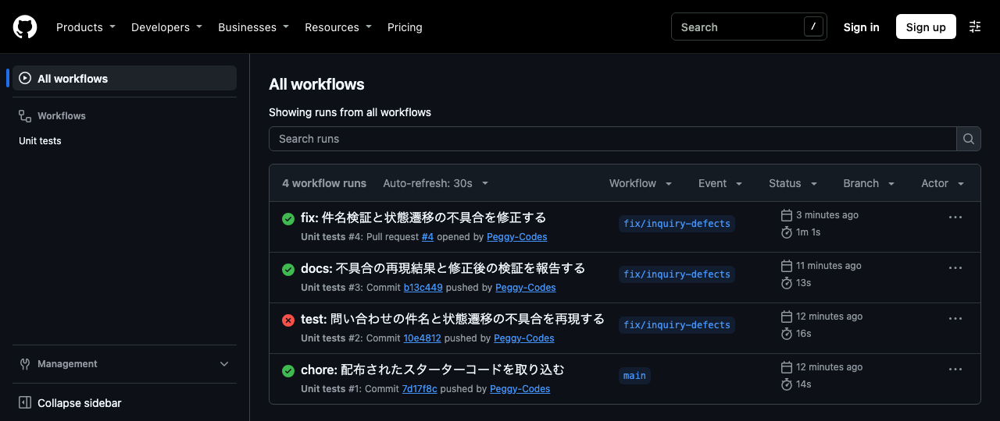
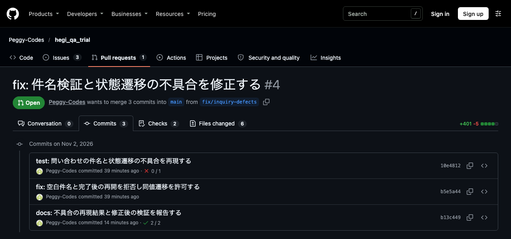

# JISSO QA Starter — 架空の問い合わせ管理ロジック

実在の患者・利用者・従業員の情報は含みません。医療・福祉の架空事業者向けの試験用コードです。UI画面は参考イメージであり、本課題の実装対象は TypeScript のロジックと Vitest に限定します。

## 準備
Node.js 20+ で `npm install` → `npm test`。GitHub に公開しても差し支えないダミーデータのみです。

## 課題（上限3〜4時間）
1. `src/inquiry.ts` の機能仕様を読み、正常・異常を含むテストケース約6件を `TEST_CASES.md` に記載。
2. `validateInquiry` の空白のみ件名入力、および `canTransition` の closed→new の2不具合を再現。期待と実際を説明。
3. 不具合を検出する自動テストを3〜4件追加。余裕があれば最小修正を行い、実行結果を示す。
4. README に環境・再現手順・実行結果を追記し、変更点と改善提案（最大3点）を記載。
5. GitHub上で差分・テスト結果を説明（PR相当の文章でも可）。

## 仕様
- 件名は trim 後に1文字以上必要。
- status は `new` / `in_progress` / `closed`。`closed` から他状態への変更は禁止。
- `new`→`in_progress`→`closed` は許可。遷移なし（同値）は許可。
- 一覧フィルタは指定状態だけを返し、元の配列を変更しない。

## 完成条件
- 追加テスト3件以上とケース一覧6件程度
- 2不具合の再現記録と期待結果
- テスト実行コマンドおよび結果、変更差分、改善提案
- 実データ・秘密情報を含まない

## 評価
仕様・境界値（30点）／再現性（25点）／自動テストの品質（25点）／報告・GitHub運用（20点）。

## 注意
試験開始前に報酬・所要時間・雇用条件・納期に双方合意すること。作業開始を求めるものではありません。

## 課題報告

件名検証と状態遷移の不具合3件を再現し、2関数を最小修正しました。既存3件に13件のテストを追加し、修正前は8件成功・8件失敗、修正後は16件すべて成功しました。対象は TypeScript のロジックと Vitest です。

### 成果物一覧

| 成果物 | 場所 |
|---|---|
| テストケース一覧 | [TEST_CASES.md](TEST_CASES.md)(基本6件と境界値・追加7件) |
| 不具合再現手順書 | 本節の[不具合再現](#不具合再現)、[TEST_CASES.md の再現記録](TEST_CASES.md#再現記録)、Issue [#1](https://github.com/Peggy-Codes/hegi_qa_trial/issues/1)・[#2](https://github.com/Peggy-Codes/hegi_qa_trial/issues/2)・[#3](https://github.com/Peggy-Codes/hegi_qa_trial/issues/3) |
| 追加した自動テストコード | [tests/inquiry.test.ts](tests/inquiry.test.ts) |
| 修正コード | [src/inquiry.ts](src/inquiry.ts) |
| テスト実行結果 | 本節の[自動テストと実行結果](#自動テストと実行結果)、[docs/test-results/](docs/test-results/)(実行ログとスクリーンショット) |
| 改善提案書 | 本節の[改善提案](#改善提案最大3件) |
| 変更差分と説明 | [PR #4](https://github.com/Peggy-Codes/hegi_qa_trial/pull/4) |

### 再現環境

- OS: macOS 26.5.2 / Darwin 25.5.0 / arm64
- Node.js: 24.4.1
- npm: 11.4.2
- Vitest: 2.1.9

### 不具合再現

| 番号 | 内容 | 期待 | 実際(修正前) | 原因 | 対応ケース | GitHub Issue |
|---|---|---|---|---|---|---|
| 1 | 空白だけの件名を受理します | 半角・全角・タブ改行だけの件名は `false` | いずれも `true` | trim 前の文字数を判定しています | T02・T07・T08 | [#1](https://github.com/Peggy-Codes/hegi_qa_trial/issues/1) |
| 2 | 完了後に再開できます | `closed`→`new`・`closed`→`in_progress` は `false` | いずれも `true` | `closed` からの変更を禁止する条件がありません | T05・T11 | [#2](https://github.com/Peggy-Codes/hegi_qa_trial/issues/2) |
| 3 | 同値遷移を拒否します | 3状態とも同値なら `true` | 3状態とも `false` | `from !== to` が同値を拒否しています | T13 | [#3](https://github.com/Peggy-Codes/hegi_qa_trial/issues/3) |

不具合3は、課題に記載がなく、仕様との照合で見つけたものです。入力・原因・影響の詳細は [TEST_CASES.md の再現記録](TEST_CASES.md#再現記録)に記載しています。同ファイルの2つのケース表で、修正前後の結果と自動テスト名を対応づけています。

再現手順(Node.js 20 以上):

1. リポジトリを clone し、`npm ci` を実行します。
2. `git checkout 10e4812` で、不具合検出テストを追加した修正前のコミットに切り替えます。
3. `npm test` を実行すると、不具合1〜3に対応する8件が失敗します。
4. `git switch -` で元のブランチに戻り、`npm test` を実行すると16件すべて成功します。

### 自動テストと実行結果

Node.js 20 以上で、リポジトリ直下から実行します。

```bash
npm ci
npm test
```

テストごとの結果を表示する場合は `npx vitest run --reporter=verbose` を実行します。下表の実行ログは、この出力を保存したものです。

| 実行対象 | 成功 | 失敗 | 合計 | 実行ログ |
|---|---|---|---|---|
| 配布時の既存テスト | 3 | 0 | 3 | 追加前に `npm test` で確認しました |
| 不具合検出テストの追加後・修正前 (`10e4812`) | 8 | 8 | 16 | [before-fix.txt](docs/test-results/before-fix.txt) |
| 修正後 (`b5e5a44`) | 16 | 0 | 16 | [after-fix.txt](docs/test-results/after-fix.txt) |

追加したテストは13件です。空白件名3件、完了後の再開2件、同値遷移3件が修正前に失敗しました。正常な件名2件、正規の遷移2件、一覧抽出と元配列の維持1件は、修正前後とも成功しました。

GitHub Actions でも同じ結果を確認しました。修正前の `10e4812` だけを先に push して CI が失敗することを確かめ、その後に修正以降を push して成功を確かめています。

| 時点 | CI の結果 |
|---|---|
| 修正前 (`10e4812`) | [失敗(8件失敗・8件成功)](https://github.com/Peggy-Codes/hegi_qa_trial/actions/runs/41421724899) |
| 修正後 (`b13c449`) | [成功(16件成功)](https://github.com/Peggy-Codes/hegi_qa_trial/actions/runs/41421803110) |





### 修正差分・GitHub PR URL

- [src/inquiry.ts](src/inquiry.ts): 件名を trim 後に検証し、同値遷移を許可したうえで `closed` から他状態への変更を拒否します。
- [tests/inquiry.test.ts](tests/inquiry.test.ts): 既存3件を維持し、ケースID付きのテスト13件を追加しました。複数入力はラベル付きの `it.each` で検証します。
- [docs/test-results/](docs/test-results/): 修正前後の実行ログを出力のまま保存し、GitHub Actions のスクリーンショットを追加しました。
- [TEST_CASES.md](TEST_CASES.md): 修正後の結果、自動テスト名、修正前を再現するコミットを記載しました。
- [README.md](README.md): 環境・再現手順・結果・改善提案・AI ツールの利用を追記しました。

差分は `git diff 7d17f8c..HEAD -- src/inquiry.ts tests/inquiry.test.ts` で確認できます。ブランチは `fix/inquiry-defects`、コミットは `test:` → `fix:` → `docs:` の順です。

GitHub PR URL: https://github.com/Peggy-Codes/hegi_qa_trial/pull/4

### 改善提案（最大3件）

1. 状態遷移を許可表で定義します。`new`→`closed`(未対応のまま完了)と `in_progress`→`new`(差し戻し)の可否を仕様で確定し、3×3の全組み合わせを表でテストします。同値遷移を拒否する実装も検出しやすくなります。
2. 完了後の再開は、通常の状態変更と分けた操作にします。配布時のコメント「権限なしに再開してはならない」から、権限者による再開の需要が考えられます。再開できる人、理由の入力、変更履歴の記録を仕様として決めます。
3. 件名は検証だけでなく、正規化してから保存します。trim 後の値を保存し、最大文字数も仕様に入れて境界値テストを追加します。前後の空白がそのまま一覧に表示されるのを防ぎます。

### AI ツールの利用

利用内容の下書きです。提出前に人間が実態と照らし、用途と検証状況を確定します。

| ツール | 用途 |
|---|---|
| Claude Code | 課題資料の読み取りと整理、仕様と実装の照合、テストケースと再現記録の下書き、差分のレビュー |
| Codex CLI | 自動テストと最小修正のコード作成、README 報告の下書き |

検証したことと、残っている確認事項です。チェック済みは今回のローカル実行による確認です。人間による検証は提出前に確認します。

- [x] 修正前のコードで全パターンを実行し、`TEST_CASES.md` の「実際」と一致することを確かめました。
- [x] 追加したテストが修正前に失敗し、修正後に成功することをローカルで確認しました。
- [ ] 同じ失敗・成功を GitHub Actions で確認します。
- [x] テストの期待値を1件ずつ README の仕様と照らし合わせました。
- [x] `src/inquiry.ts` の差分を読み、仕様にない遷移の挙動を変えていないことを確認しました。
- [ ] 差分のレビューを完了し、この利用表を実態に合わせて確定します。

### 実作業時間

実作業時間:
